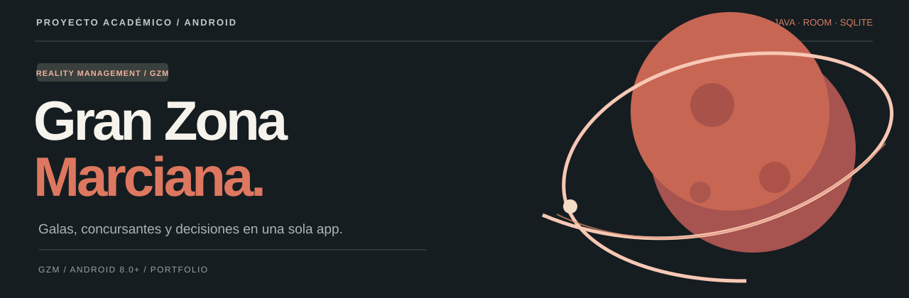

# Gran Zona Marciana

**Una aplicación Android para gestionar un reality: concursantes, ediciones, galas, noticias e inscripciones, con votaciones del público.**

### [**Explorar la plataforma interactiva**](https://juanjogamero.github.io/GranZonaMarciana/) · [**Ver código Android**](Codigo/app/src/main/java/com/granzonamarciana) · [**Compilaciones APK**](https://github.com/juanjogamero/GranZonaMarciana/actions/workflows/android.yml)

**Java · Android · Room · SQLite · Material Components**

> **La versión web es una vista de portfolio**, no la aplicación Android ejecutada en el navegador. Usa datos ficticios y guarda los cambios localmente. Para probar el software nativo hay que instalar su APK o utilizar un emulador.

## Así es el proyecto

**Gran Zona Marciana** nació como trabajo académico del equipo **Ecentia**. El objetivo es ofrecer una experiencia móvil para organizar un reality show, con perfiles de administrador, espectador y concursante.

La aplicación permite consultar noticias, gestionar temporadas y galas, solicitar una plaza y emitir puntuaciones de **1 a 10**. La edición de datos está organizada en actividades, adaptadores, servicios y entidades Room.

## Explora la aplicación

<table><tr>
<td align="center" width="33%"> Inicio de sesión</td>
<td align="center" width="33%"> Menú principal</td>
<td align="center" width="33%"> Gestión de galas</td>
</tr><tr>
<td align="center"> Solicitud de participación</td>
<td align="center"> Puntuación del público</td>
<td align="center"> Actualidad del reality</td>
</tr></table>
Capturas originales del proyecto Android. La vista web tiene su propio diseño.

## Qué incluye

| Apartado | Funcionalidad |
| --- | --- |
| **Ediciones** | Fechas de temporada y máximo de participantes |
| **Galas** | Programación de eventos vinculados a una edición |
| **Concursantes** | Perfiles y rol de participante |
| **Votaciones** | Puntuaciones entre 1 y 10 durante las primeras 24 horas |
| **Solicitudes** | Inscripción como espectador; aprobación o rechazo desde administración |
| **Noticias** | Publicación y consulta de novedades del programa |
| **Datos locales** | Room sobre SQLite; funcionamiento sin servidor externo |

### Mejoras sobre la versión inicial

Se han revisado las reglas de negocio y las operaciones de la base de datos. Los votos y las solicitudes tienen **restricciones contra duplicados**, y las aprobaciones se procesan en una transacción para **respetar el cupo de plazas** y cambiar el rol de los candidatos aceptados.

El primer administrador ya no se crea con una contraseña conocida: **configuras su cuenta en el primer arranque**. Los datos de ejemplo que se insertan automáticamente se limitan al contenido editorial ficticio.

## Ejecutar Android

Necesitas **Android Studio**, **JDK 17** y Android SDK 34. El proyecto está en la carpeta [\`Codigo/\`](Codigo/).

1. Clona el repositorio y abre **\`Codigo/\`** desde Android Studio.
2. Sincroniza las dependencias Gradle.
3. Ejecuta la configuración \`app\` en un emulador o dispositivo Android 8.0 (API 26) o posterior.
4. En la primera apertura, crea tu usuario administrador y su contraseña.
5. Desde ese perfil podrás configurar ediciones y galas.

También puedes compilar desde la terminal, dentro de \`Codigo/\`:

~~~bash
bash ./gradlew :app:assembleDebug :app:testDebugUnitTest
~~~

En Windows utiliza \`gradlew.bat\`. Encontrarás la APK local en \`Codigo/app/build/outputs/apk/debug/app-debug.apk\`. GitHub Actions genera una APK de depuración como artefacto en cada ejecución satisfactoria.

### Pruebas y tecnología

El código nativo utiliza **Java**, **Room 2.6**, **SQLite**, componentes de **Material Design** y **BCrypt** para el almacenamiento de contraseñas. La compilación automatizada genera un APK de pruebas y ejecuta los tests unitarios de las reglas de negocio.

La web de portfolio utiliza HTML, CSS y JavaScript sin dependencias de frontend. Sus reglas de muestra se verifican con Node.js.

## Organización del repositorio

~~~text
Codigo/
  app/src/main/java/com/granzonamarciana/
    activity/    Pantallas y formularios Android
    adapter/     Adaptadores de listas
    entity/      Modelos Room
    dao/         Consultas a la base de datos
    service/     Reglas de negocio
    database/    Room, migraciones y datos iniciales
    rules/       Reglas verificables con JUnit
  screenshots/   Capturas originales
Documentacion/    Requisitos y diagrama UML académico
docs/             Vista web interactiva
scripts/          Pruebas del simulador web
~~~

## Alcance y limitaciones

Es una aplicación **académica local**, no una plataforma de producción sincronizada entre múltiples dispositivos. Los roles y la sesión se gestionan en el dispositivo; no hay un backend remoto de autorización ni verificación externa de los votos. La versión web usa datos simulados, no comparte la base SQLite y no representa un programa de televisión real.

**Importante si ya utilizaste una versión anterior:** se ha añadido una migración Room de la versión 7 a la 8 para crear índices de unicidad. En instalaciones con datos duplicados se conservan los registros de menor ID para las combinaciones repetidas de voto o solicitud. Conviene hacer una copia de los datos antes de actualizar. Las versiones anteriores a la 7 pueden requerir reinstalación por falta de migraciones históricas.

El proyecto original y la documentación académica se mantienen para mostrar su evolución.

---

**[Abrir Gran Zona Marciana en el navegador](https://juanjogamero.github.io/GranZonaMarciana/)**

Vista interactiva con datos ficticios · La app real es nativa de Android

